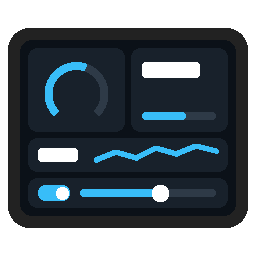

# ioBroker.satellite-display

[](https://www.npmjs.com/package/iobroker.satellite-display)
[](https://www.npmjs.com/package/iobroker.satellite-display)
[](LICENSE)

[](https://nodei.co/npm/iobroker.satellite-display/)


Tile pages on the touch display of ESPHome voice satellites, filled from ioBroker: values, gauges, charts,
switches, dimmers and buttons, each bound to a state. A touch on a switch, a dimmer or a button writes the state.

It is made for the [Waveshare ESP32-S3-AUDIO voice satellite](https://github.com/sadam6752-tech/esphome-waveshare-esp32-s3-audio-va)
with the [Waveshare 2.8inch Capacitive Touch LCD](https://www.waveshare.com/wiki/2.8inch_Capacitive_Touch_LCD)
(firmware **2.0.0** or newer). The voice of the satellite stays with
[ioBroker.assistant](https://github.com/ioBroker/ioBroker.assistant): this adapter opens its own connection to the
ESPHome Native API next to it and only handles the display.

A display without voice works too: the firmware repository has `panel-lcd2.yaml` for the
[Waveshare ESP32-S3-Touch-LCD-2](https://www.waveshare.com/wiki/ESP32-S3-Touch-LCD-2), a 2 inch tile panel with the
same tile pages and screen lock. Add it like a satellite (IP address, port 6053).

```
ioBroker states  ──▶  satellite-display  ──▶  satellite (tile pages)
       ▲                                           │
       └──────────────  a touch on a tile  ◀───────┘
```

## Tiles

Each satellite has up to **4 pages**. A page is a grid of 2 columns × 4 rows on the 320 × 240 screen and holds up
to 8 tiles. Swipe left from the clock to reach them; a page without tiles is skipped.

| Size | Cells | Pixels |
| --- | --- | --- |
| small | 1 × 1 | 151 × 52 |
| square | 1 × 2 | 151 × 111 |
| wide | 2 × 1 | 308 × 52 |
| large | 2 × 2 | 308 × 111 |

| Kind | Shows | Sizes | A touch |
| --- | --- | --- | --- |
| Value | name, number with unit, or a text | all | – |
| Gauge | name, arc from the scale start to its end, number | square, large | – |
| Value with bar | name, number, bar along the scale | all | – |
| Value with chart | name, number, line of the last 60 values | small, wide, large | – |
| Switch | name, toggle; the tile lights up when on | small, square, wide | toggles the state |
| Dimmer | name, toggle, slider, percent | wide, large | toggle and slider write the states |
| Button | icon, name | small, square, wide | writes `true` to the state |
| Thermostat | name, arc with the current temperature, − target +, a dot for the heating relay | square, large | − and + write the target |

## Settings

1. **Satellites:** name (room), IP address and API port (6053) of each satellite. An API encryption key is only needed
   when you built the firmware with one; the ready-made firmware has none.
2. **Tiles:** a graphical editor. Choose the satellite and the page; the preview shows the screen with the current
   values. Click a free cell to add a tile, drag a tile to a free cell to move it or onto another tile to swap the
   two, click a tile to edit it on the right: kind, size, the state (with the object browser of the admin), name,
   unit, icon and scale. Choosing a state fills in its name and unit; you can change them. Name, unit and scale may
   also stay empty: they come from the object of the state. "Copy page" copies the page to another page or
   satellite, Ctrl+Z undoes the last changes. "Show on the satellite" puts the tiles of the editor on the satellite
   without saving, to try sizes and places (the instance must run). A tile the adapter would leave out is marked red, with the reason (a
   size its kind does not come in, a thermostat without its target, more than eight tiles on a page).
3. **Charts (optional):** a history adapter (history, sql, influxdb). A chart then starts with the last hours of its
   state instead of empty.

Details of the kinds:

- **Switch:** reads the state as on/off (`true`, a number other than 0, `"on"` …) and writes the type of the state
  (`true`/`false`, `1`/`0`).
- **Dimmer:** the state is the level, 0-100 or the range of its object (`min`/`max`, e.g. 0-1 or 0-255); the slider
  writes the level when it is released. The second state is its on/off. Without a second state a level of 0 is off,
  and switching on restores the last level.
- **Button:** writes `true` (or `1` for a number state), e.g. to a scene or a script trigger.
- **Colours:** the tab **Appearance** sets the main colour of all tiles (value, arc, bar, line, toggles); a tile can
  have its own main colour and background. A **background state** colours the tile from another state: while it is
  on (`true`, a number other than 0) the tile takes the chosen colour; a state that holds a colour (`#7F1D1D`) gives
  that colour, e.g. from a script. A threshold still turns the tile red. Needs the satellite firmware **2.0.4** for
  the background (the main colour works from 2.0.3).
- **Icons:** every kind can show an icon. A small (1 × 1) or wide tile shows it left in the middle, a large one top
  left; the square tiles (1 × 2) keep their layout. "Only the icon" puts it in the place of the name. A small or wide
  switch with an icon and a name has no toggle: the whole tile is the switch and lights up when on; with only the
  icon it keeps the toggle. "The whole tile switches" sets this for every switch, the square one too. Needs the
  satellite firmware **2.0.4**.
- **Thresholds:** value, gauge, bar, chart and thermostat tiles have "Red below" and "Red above": beyond them the
  value and its arc, bar or line turn red, e.g. a battery below 20 %. Needs the satellite firmware **2.0.3**; an older
  one keeps the colours.
- **Thermostat:** three states: the current temperature (the arc), the target temperature (written by − and +)
  and, optional, the heating relay (the dot: green on, grey off). − and + change the target on the screen at
  once by the step (0.5 unless set); one second after the last press the adapter writes it. The scale and the
  limits of the target come from the object of the target temperature (`min`/`max`), else 5-30. Needs the
  satellite firmware **2.0.1**; an older firmware is reported in the log and the tile is left out.
- A value that is no number (text, `true`/`false`) shows as text on a value tile. When the object of the state has
  `common.states` (e.g. `0: Aus, 1: Heizen, 2: Kühlen`), the value tile shows that text instead of the number.

The toggle and the slider change at once on the screen. When the device does not follow, the tile shows the real
state again after three seconds.

## Screen lock

A satellite can be locked with a PIN of 4 to 6 digits (tab **Satellites**: "Screen lock" and "PIN"). While it is
locked the display shows only the clock and the date and a lock instead of the gear; the pages of tiles, the system
page and the settings cannot be reached, and the satellite does not react to the wake word. Announcements, alarms,
timers and music still sound. A touch opens a keypad; the PIN is checked as soon as all digits are typed. After 5
wrong PINs in a row the keypad waits a minute; without a key it closes after 30 seconds.

The tab **Authentication** decides when an unlocked satellite locks again: after some minutes without a touch, when
the display goes back to the clock by itself, or only by hand. The open lock next to the gear locks at once in every
mode. The state `satellites.<name>.locked` shows the lock and locks or unlocks from ioBroker (e.g. at night or with
the alarm system); `satellites.<name>.failedPins` counts the wrong PINs.

The PIN does not leave ioBroker: the satellite gets its SHA-256 hash and keeps it in its flash, so the lock also
works after a restart and without ioBroker. Needs the satellite firmware **2.1.0**.

## States

| State | Meaning |
| --- | --- |
| `info.connection` | all satellites are connected and have their tiles |
| `satellites.<name>.connected` | this satellite is connected and has its tiles |
| `satellites.<name>.lastTouch` | the last touch on a tile, as JSON (`page`, `slot`, `input`, `value`, `ts`) |
| `satellites.<name>.resend` | button: sends all tiles again |
| `satellites.<name>.locked` | the screen is locked; write `true` / `false` to lock or unlock (only with a screen lock) |
| `satellites.<name>.failedPins` | wrong PINs in a row on the display (only with a screen lock) |
| `satellites.<name>.media.url` | play this stream URL (only displays with a player, e.g. the tile panel with an I2S amplifier); empty = stop |
| `satellites.<name>.media.volume` | volume 0-100 % |
| `satellites.<name>.media.title` | title shown in the bar of the clock while it plays (e.g. the station) |
| `satellites.<name>.media.stop` | button: stop playing |
| `satellites.<name>.media.state` | `playing`, `paused`, `announcing` or `idle` |
| `satellites.<name>.brightness` | brightness of the display 0-100 %, 0 = dark (only displays that take it from ioBroker, e.g. the tile panel) |

The satellite keeps no layout: after a restart or a lost connection the adapter sends all tiles and their values
again by itself.

## Notes

- The small bar and chart tiles (1 × 1) need the satellite firmware **2.0.2**; an older one leaves them empty and
  writes a warning into its own log.
- The satellite firmware must be **2.0.0** or newer; an older firmware is reported in the log ("tile pages need the
  satellite firmware 2.0.0").
- The format between adapter and firmware is described in
  [docs/TILES.md of the firmware](https://github.com/sadam6752-tech/esphome-waveshare-esp32-s3-audio-va/blob/main/docs/TILES.md).
- The icons are a fixed set built into the firmware; the settings offer exactly that list.
- After an update of the adapter, reload the admin page (F5) once: an open admin keeps the old tile editor in memory.

## Changelog

Older changes: [CHANGELOG_OLD.md](CHANGELOG_OLD.md)

<!--
    Placeholder for the next version (at the beginning of the line):
    ### **WORK IN PROGRESS**
-->

### **WORK IN PROGRESS**

- `media.url` plays only an `http://` or `https://` address; an empty value or `stop` (as other players of ioBroker
  take it, e.g. ioBroker.spotify-connect) stops the player

### 0.1.1 (2026-11-10)

- The tile panel without voice (Waveshare ESP32-S3-Touch-LCD-2, `panel-lcd2.yaml` of the firmware) works as a
  satellite; its state `satellites.<name>.brightness` sets the brightness of the display (0 = dark)
- A display with a player (the panel with a MAX98357A amplifier) gets `satellites.<name>.media.*`: a stream URL to
  play (e.g. from an AirPlay receiver), volume, stop and its state

### 0.1.0 (2026-11-10)

- Screen lock with a PIN per satellite (tab Satellites): the display shows only the clock and a lock, the wake word is
  ignored, a touch opens a keypad; the satellite checks the PIN itself (satellite firmware 2.1.0)
- Tab Authentication: lock again after some minutes without a touch, when the display goes back to the clock, or only
  by hand; the state `satellites.<name>.locked` locks and unlocks from ioBroker

### 0.0.8 (2026-11-10)

- Colours: a default main colour of the tiles (tab Appearance), an own main colour and background per tile, and a
  background from another state (on = a chosen colour, or a colour `#RRGGBB` written into the state)
- Icons on the small, wide and large tiles of every kind, "only the icon" instead of the name; a small or wide
  switch with an icon and a name becomes a tile switch without the toggle (satellite firmware 2.0.4)

### 0.0.7 (2026-11-09)

- Thresholds: "Red below" / "Red above" turn the value and its arc, bar or line red beyond a value (satellite
  firmware 2.0.3)

### 0.0.6 (2026-11-09)

- Tile editor: "Show on the satellite" sends the tiles as they are in the editor to the satellite, without saving
  (back to the saved tiles with "End preview", after saving, or after 10 minutes)
- The chart preview draws the real history of the state when a history adapter is set
- A value tile shows the text that `common.states` of the object gives the value (e.g. 1 → "Heizen")
- The editor warns about a state that does not exist, a read-only state on a switch, and a number tile on a state
  that is no number

## License

MIT License

Copyright (c) 2026 sadam6752-tech <sadam6752@gmail.com>

Permission is hereby granted, free of charge, to any person obtaining a copy
of this software and associated documentation files (the "Software"), to deal
in the Software without restriction, including without limitation the rights
to use, copy, modify, merge, publish, distribute, sublicense, and/or sell
copies of the Software, and to permit persons to whom the Software is
furnished to do so, subject to the following conditions:

The above copyright notice and this permission notice shall be included in all
copies or substantial portions of the Software.

THE SOFTWARE IS PROVIDED "AS IS", WITHOUT WARRANTY OF ANY KIND, EXPRESS OR
IMPLIED, INCLUDING BUT NOT LIMITED TO THE WARRANTIES OF MERCHANTABILITY,
FITNESS FOR A PARTICULAR PURPOSE AND NONINFRINGEMENT. IN NO EVENT SHALL THE
AUTHORS OR COPYRIGHT HOLDERS BE LIABLE FOR ANY CLAIM, DAMAGES OR OTHER
LIABILITY, WHETHER IN AN ACTION OF CONTRACT, TORT OR OTHERWISE, ARISING FROM,
OUT OF OR IN CONNECTION WITH THE SOFTWARE OR THE USE OR OTHER DEALINGS IN THE
SOFTWARE.
